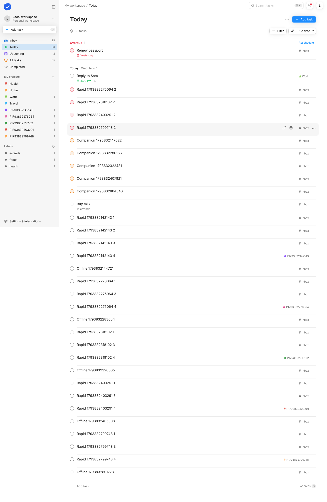

# Tasks

A self-hosted task manager for the web, macOS, iPhone, and AI tools. Built for DigitalOcean with Sign in with Apple.



## Included

- Responsive React web app with Inbox, Today, Upcoming, projects, labels, search, priorities, completed history, and keyboard shortcuts.
- Create, edit, complete, restore, and delete tasks, with checklists inside each task. Daily, weekly, and monthly recurrence. Project deletion keeps tasks in Inbox.
- Native SwiftUI macOS and iOS applications using the same backend. Apple sign-in, Keychain sessions, projects, task editing, search, API tokens, and account deletion.
- English quick task entry with a preview, due times and time zones, reminders, Web Push, and native Apple push integration. Push delivery requires server configuration and device permission.
- Versioned REST API and generated OpenAPI contract.
- MCP over stdio and authenticated Streamable HTTP, with eight task and project tools.
- Sign in with Apple code exchange, signature/audience/issuer/expiry/nonce validation, one-time challenges, browser binding, and revocable sessions.
- PostgreSQL production storage, Alembic migrations, Docker image, DigitalOcean App Platform specification, and Droplet deployment with automatic HTTPS through Caddy.

This is an online-first first release. It does not yet include shared projects, subtasks, comments, attachments, calendar integrations, or offline editing. It is an independent app and does not use Todoist branding or services.

## Inside Personal Command

Tasks is one of the apps in Personal Command, the shell at westley.app (repo `awestley/westley-app`). It follows the shell's app contract (`docs/app-contract.md` there): the shell signs people in, opens Tasks views in columns, searches it with everything else, and lets other apps embed tasks and projects.

Set `SHELL_URL` to turn this on. Then:

- Sign in is the shell's. The API verifies the shell's ES256 access token (the `pc_session` cookie, or `Authorization: Bearer`) against `SHELL_URL/auth/.well-known/jwks.json` (or `SHELL_JWKS_URL`), and keys data by the token's `sub`. This app's own Apple and development sign in are turned off. Personal access tokens for MCP and scripts keep working.
- The app is served under `BASE_PATH` (`/apps/tasks`) as well as at the root (health checks), and can be framed by the same origin only.
- `GET /apps/tasks/manifest.json` describes it to the shell. Contract endpoints live in the API: `GET /api/v1/resolve`, `/search` (the shared search contract, ported in `api/taskwell/search.py`), `/references`, `/events` (server-sent events), plus `GET /tasks/{id}` and `GET /projects/{id}`. Creates accept a client-chosen UUID `id`, and replaying one returns the existing item.
- Pane routes: `#/today`, `#/inbox`, `#/upcoming`, `#/all`, `#/completed`, `#/project/<id>`, `#/label/<name>`, `#/task/<id>`. It is the same app at every size: in a wide column the sidebar (views, projects, labels) is docked and a task opens beside the list; in a narrow one the sidebar is a drawer (M toggles it) and a task opens over the list. The theme follows the shell.
- The companion (`companion.html`) is the same app in its compact layout: a capture field first, a list picker, Space completes, ⌘Enter opens the task in a column, Escape twice hides it. The shell's quick add (`new-task`) focuses that field.
- `embed.js` defines `<tasks-task>` and `<tasks-project>`. Other apps show them through the shell runtime's `<pc-embed ref="pc://tasks/task/<id>">`. A task description can link `[[note:<id>]]` or embed `![[note:<id>]]` items from other apps.
- Styles come from `@awestley/glassive`, and the bridge from `@awestley/pc-runtime`. Both are private packages, vendored into `web/vendor/` until the build can install them from GitHub Packages; refresh them with `npm --prefix web run sync-vendor -- <obsidian-glassive> <westley-app>`.

Run it inside the shell locally:

```sh
# Tasks API on :8000, serving the built web app
npm --prefix web run build
cd api && SHELL_URL=http://127.0.0.1:8080 PUBLIC_URL=http://127.0.0.1:8080 BASE_PATH=/apps/tasks \
  .venv/bin/uvicorn taskwell.main:app --port 8000
# The shell on :8080 (in westley-app), proxying /apps/tasks to it
PC_APPS=tasks=/apps/tasks/=http://127.0.0.1:8000 npm run dev
```

Offline: every view keeps a local replica and an outbox in `localStorage` (shared by the column, the companion and any tab, with one sender at a time through Web Locks). Changes show at once and sync in the background; new items get client-made UUIDs; a `409` re-applies the changed fields on top of the newer copy. The service worker keeps the app's files and answers `/search` and `/resolve` with `503 offline` when there is no connection, so the manifest declares `offline`.

## Run locally

Requirements: Python 3.12+, uv, Node 24+, npm. Apple credentials are not needed for local development.

```sh
./scripts/dev.sh
```

Open http://localhost:5173 and choose **Open local workspace**. New workspaces start empty and are stored in `api/taskwell.db`. It is a single shared local account, not a production authentication method. The API binds to loopback only. `DEV_LOGIN` defaults to false unless explicitly enabled, and production refuses to start with it enabled.

To start each component separately:

```sh
cp api/.env.example api/.env
uv sync --directory api --python 3.12
npm --prefix web ci
# Terminal 1:
cd api
.venv/bin/uvicorn taskwell.main:app --host 127.0.0.1 --port 8000
# Terminal 2, from the repository root:
npm --prefix web run dev
```

Development startup applies database migrations automatically. An original unversioned SQLite database is backed up into `api/.backups/` before its first migration. Keep that directory private, since backups contain workspace data. Production migrations run separately before deployment.

The web app saves every change locally first, sends it in the background, and follows server-sent events (polling every 30 seconds as a fallback). Native apps refresh on activation and support manual refresh. Dates are calendar dates; clients render them in the local calendar. Completion timestamps in the API are UTC. Recurrence advances one interval from the scheduled date, including overdue tasks; monthly recurrence clamps to the destination month's last day. Reopening a completed recurring occurrence keeps its successor, except through Undo (`undo: true` on the reopen), which removes the successor if it has not been touched.

Checklists support up to 100 items per task. Completing a task checks its remaining items; a recurring successor starts with every item unchecked. Reopening a task preserves its checkmarks. Checking the last item does not automatically complete the task.

[Quick entry and push setup](docs/reminders.md) explains supported phrases, reminder timing, VAPID configuration, and Apple push provisioning.

## Apple applications

```sh
xcodegen generate --spec apple/project.yml
open apple/Taskwell.xcodeproj
```

Choose `Taskwell-macOS` or `Taskwell-iOS`. Set your Development Team and real bundle identifiers in `apple/project.yml`, regenerate, and build. Enter the backend's HTTPS origin on the app's connection screen. Simulator interaction tests use local ad hoc signing (`CODE_SIGNING_ALLOWED=YES CODE_SIGN_IDENTITY=-`) so Keychain works. Unsigned builds only verify compilation. Distribution requires your Apple signing identities and provisioning profiles.

Debug builds include a development-token entry so you can use a token from the local web app with `http://localhost:8000` in the Mac app or iOS Simulator. This entry is excluded from Release builds. API tokens intentionally cannot create more tokens or delete the account, so those settings require Apple sign-in. A physical phone requires an HTTPS backend reachable from that device.

[Apple setup](docs/apple-auth.md) covers identifiers, app grouping, return URLs, keys, and distribution.

Run the iOS UI test with `bash scripts/test-ios.sh SIMULATOR_UDID` (find a device with `xcrun simctl list devices`). It starts an isolated backend on port 8002, uses a temporary session, and removes its database when finished, including after a failed test. Test results are in `apple/DerivedData-iOS/Logs/Test`.

## API and MCP

API base: `https://YOUR_DOMAIN/api/v1`. Generate a personal access token in **Settings & integrations** and send `Authorization: Bearer TOKEN`. Tokens are shown once, hashed in storage, expire in 90 days, and can be revoked at any time. They can manage tasks and projects but cannot mint credentials or delete the account. Sessions expire in 30 days; sign in again afterward.

The authoritative schemas are in the server code. The generated snapshot is [docs/openapi.json](docs/openapi.json). [Contract semantics](docs/contract.md) explain pagination, conflicts, authorization, and recurrence.

Remote MCP URL: `https://YOUR_DOMAIN/mcp/`, with an Authorization bearer header. This release uses personal tokens, not MCP OAuth discovery. Use the stdio adapter for clients that cannot configure a bearer header.

```json
{
  "mcpServers": {
    "taskwell": {
      "command": "/absolute/path/to/taskwell/api/.venv/bin/python",
      "args": ["-m", "taskwell.mcp_server"],
      "cwd": "/absolute/path/to/taskwell/api",
      "env": {
        "TASKWELL_API_URL": "https://YOUR_DOMAIN",
        "TASKWELL_TOKEN": "YOUR_PERSONAL_ACCESS_TOKEN"
      }
    }
  }
}
```

Keep actual tokens in your client's secret store or private configuration. Never commit them. Tools: `list_tasks`, `list_projects`, `create_task`, `update_task`, `complete_task`, `delete_task`, `create_project`, `parse_task`. Read a task's version before modifying it. A stale update returns 409 rather than silently overwriting another device's change.

## Deploy

See [DigitalOcean deployment](docs/deployment.md). Both App Platform and a Droplet are supported. No cloud resources have been created by this project. The specification has placeholders for the repository, domain, database cluster, and Apple credentials.

## Verification

```sh
# Core API tests, using isolated SQLite databases:
cd api
.venv/bin/pytest -q
# Include Apple integration cases with the local simulation running:
APPLE_SIMULATION_URL=http://localhost:4900/apple .venv/bin/pytest -q

# From the root, with the local app running:
api/.venv/bin/python scripts/check_mcp.py
npm --prefix web run build
cd web
npx playwright install chromium
npm test
```

The browser test uses the real backend and local development account, creates test resources, verifies persisted edits, completion/restoration, project management and token revocation, then removes its test resources. Set `CHROME_PATH` if using an already-installed Chromium binary.

PostgreSQL tests use `TEST_DATABASE_URL`. **Use a disposable database only:** the test fixtures recreate Taskwell's tables. Never point it at a real workspace. Migration verification uses `alembic upgrade head` and `alembic check`.

For Apple contract testing, start the included simulation from the repository root:

```sh
postman simulation run postman/simulations/apple-auth/apple-auth.sim.yaml --port 4900 --output ndjson
```

[Verification notes](docs/verification.md) distinguish compiled, simulated, and live-provider evidence.
