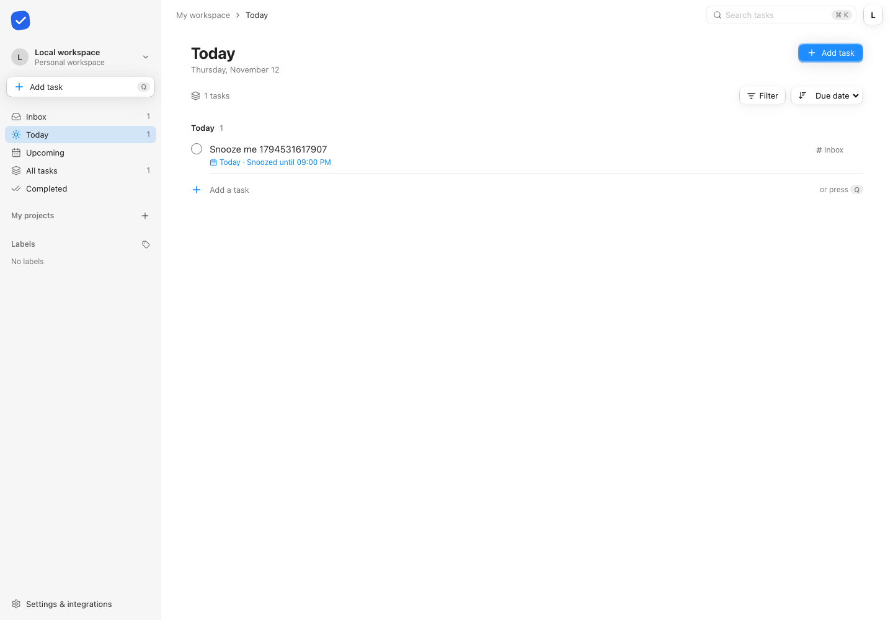

# Tasks

A self-hosted task manager for the web, macOS, iPhone, and AI tools. Built for DigitalOcean with Sign in with Apple.



## Included

- Responsive React web app with Inbox, Today, Upcoming, projects, labels, search, priorities, completed history, and keyboard shortcuts.
- Create, edit, complete, restore, and delete tasks, with checklists inside each task. Daily, weekly, and monthly recurrence. Project deletion keeps tasks in Inbox.
- Native SwiftUI macOS and iOS applications using the same backend. Apple sign-in, Keychain sessions, projects, task editing, search, API tokens, and account deletion.
- English quick task entry with a preview, due times and time zones, reminders, Web Push, and native Apple push integration. Notifications have Complete and Snooze actions, project grouping, Time Sensitive urgency, badges, an optional morning summary and overdue follow-up, Siri support, and alarm-style reminders on iPhone. Push delivery requires server configuration and device permission.
- Versioned REST API and generated OpenAPI contract.
- MCP over stdio and authenticated Streamable HTTP, with nine task and project tools.
- Sign in with Apple code exchange, signature/audience/issuer/expiry/nonce validation, one-time challenges, browser binding, and revocable sessions.
- PostgreSQL production storage, Alembic migrations, Docker image, DigitalOcean App Platform specification, and Droplet deployment with automatic HTTPS through Caddy.

This is an online-first first release. It does not yet include shared projects, subtasks, comments, attachments, calendar integrations, or offline editing. It is an independent app and does not use Todoist branding or services.

## Run locally

Requirements: Python 3.12+, uv, Node 24+, npm. The Apple builds also need Xcode and XcodeGen (`brew install xcodegen`). Apple credentials are not needed for local development.

### Build everything and start the backend

```sh
./scripts/start.sh
```

This removes old builds, installs dependencies, builds the web app, builds the macOS and iOS Simulator apps, then starts the backend at http://localhost:8000. The backend serves the web app, so open http://localhost:8000 and choose **Open local workspace**. Press Control-C to stop. Running the script again stops an earlier backend on the same port first, if the same Mac account started it.

| Option | Effect |
| --- | --- |
| `--skip-apple` | Build only the web app. The Apple builds take a few minutes. |
| `--no-build` | Start the backend with the existing builds, without cleaning or building. |
| `--no-serve` | Clean and build, then exit without starting the backend. |
| `--port PORT` | Use another port. The default is 8000. |

Build output:

- Web: `web/dist`
- macOS: `apple/DerivedData/Build/Products/Debug/Tasks.app` (unsigned, because its entitlements need a development certificate)
- iOS Simulator: `apple/DerivedData-iOS/Build/Products/Debug-iphonesimulator/Tasks.app` (ad hoc signed so the Keychain works)

In the Mac app or iOS Simulator, connect to `http://localhost:8000`.

New workspaces start empty and are stored in `api/tasks.db`. The local workspace is a single shared local account, not a production authentication method. The API binds to loopback only, and local sign-in answers only requests from this computer. `DEV_LOGIN` defaults to false unless explicitly enabled, and production refuses to start with it enabled. [Authentication design](docs/authentication.md) explains every sign-in method and its safeguards.

### Web development with live reload

```sh
./scripts/dev.sh
```

This starts the backend on port 8000 and the Vite development server at http://localhost:5173, which reloads as you edit `web/src`. Open http://localhost:5173.

### Start each component by hand

```sh
cp api/.env.example api/.env
uv sync --directory api --python 3.12
npm --prefix web ci
# Terminal 1:
cd api
.venv/bin/uvicorn tasks.main:app --host 127.0.0.1 --port 8000
# Terminal 2, from the repository root:
npm --prefix web run dev
```

Local sign-in only works from the address in `PUBLIC_URL`, which `api/.env` sets to http://localhost:5173. To use the backend's own copy of the web app at port 8000 instead, start it with `PUBLIC_URL=http://localhost:8000`, as `scripts/start.sh` does.

Development startup applies database migrations automatically. An original unversioned SQLite database is backed up into `api/.backups/` before its first migration. Keep that directory private, since backups contain workspace data. Production migrations run separately before deployment.

The web app refreshes after writes, and when focused and every 30 seconds if tasks have changed. Native apps refresh on activation and support manual refresh. There is no offline write queue. Dates are calendar dates; clients render them in the local calendar. Completion timestamps in the API are UTC. Recurrence advances one interval from the scheduled date, including overdue tasks; monthly recurrence clamps to the destination month's last day, then returns to the original day. Reopening a completed recurring occurrence does not remove its already-created successor.

Checklists support up to 100 items per task. Completing a task checks its remaining items; a recurring successor starts with every item unchecked. Reopening a task preserves its checkmarks. Checking the last item does not automatically complete the task.

[Quick entry and push setup](docs/reminders.md) explains supported phrases, reminder timing, VAPID configuration, and Apple push provisioning.

## Apple applications

```sh
xcodegen generate --spec apple/project.yml
open apple/Tasks.xcodeproj
```

Choose `Tasks-macOS` or `Tasks-iOS`. Set your Development Team and real bundle identifiers in `apple/project.yml`, regenerate, and build. Enter the backend's HTTPS origin on the app's connection screen. Simulator interaction tests use local ad hoc signing (`CODE_SIGNING_ALLOWED=YES CODE_SIGN_IDENTITY=-`) so Keychain works. Unsigned builds only verify compilation. Distribution requires your Apple signing identities and provisioning profiles.

Debug builds connected to a local development server, such as `http://localhost:8000` from the Mac app or iOS Simulator, offer **Open local workspace**, the same local account as the web app. Under **Local development** they also accept a personal access token, for pointing a Debug build at another server. Both are excluded from Release builds. API tokens intentionally cannot create more tokens or delete the account, so those settings require Apple sign-in. A physical phone requires an HTTPS backend reachable from that device.

[Apple setup](docs/apple-auth.md) covers identifiers, app grouping, return URLs, keys, and distribution.

Run the iOS UI test with `bash scripts/test-ios.sh SIMULATOR_UDID` (find a device with `xcrun simctl list devices`). It starts an isolated backend on port 8002, uses a temporary session, and removes its database when finished, including after a failed test. Test results are in `apple/DerivedData-iOS/Logs/Test`.

## API and MCP

API base: `https://YOUR_DOMAIN/api/v1`. Generate a personal access token in **Settings & integrations** and send `Authorization: Bearer TOKEN`. Tokens are shown once, hashed in storage, expire in 90 days, and can be revoked at any time. They can manage tasks and projects but cannot mint credentials or delete the account. Sessions expire in 30 days; sign in again afterward. Settings lists your signed-in devices and can end another device's session.

The authoritative schemas are in the server code. The generated snapshot is [docs/openapi.json](docs/openapi.json). [Contract semantics](docs/contract.md) explain pagination, conflicts, authorization, and recurrence.

Remote MCP URL: `https://YOUR_DOMAIN/mcp/`, with an Authorization bearer header. This release uses personal tokens, not MCP OAuth discovery. Use the stdio adapter for clients that cannot configure a bearer header.

```json
{
  "mcpServers": {
    "tasks": {
      "command": "/absolute/path/to/tasks/api/.venv/bin/python",
      "args": ["-m", "tasks.mcp_server"],
      "cwd": "/absolute/path/to/tasks/api",
      "env": {
        "TASKS_API_URL": "https://YOUR_DOMAIN",
        "TASKS_TOKEN": "YOUR_PERSONAL_ACCESS_TOKEN"
      }
    }
  }
}
```

Keep actual tokens in your client's secret store or private configuration. Never commit them. Tools: `list_tasks`, `list_projects`, `create_task`, `update_task`, `complete_task`, `delete_task`, `create_project`, `parse_task`. Read a task's version before modifying it. A stale update returns 409 rather than silently overwriting another device's change.

## Deploy

See [DigitalOcean deployment](docs/deployment.md). Both App Platform and a Droplet are supported. No cloud resources have been created by this project. The specification has placeholders for the repository, domain, database cluster, and Apple credentials.

## Verification

```sh
# API tests, using isolated SQLite databases and in-process fakes for Apple sign-in and push:
cd api
.venv/bin/pytest -q

# From the root, with the local app running:
api/.venv/bin/python scripts/check_mcp.py
npm --prefix web run build
cd web
npx playwright install chromium
npm test
```

The browser test uses the real backend and local development account, creates test resources, verifies persisted edits, completion/restoration, project management and token revocation, then removes its test resources. Set `CHROME_PATH` if using an already-installed Chromium binary.

PostgreSQL tests use `TEST_DATABASE_URL`. **Use a disposable database only:** the test fixtures recreate the tables. Never point it at a real workspace. Migration verification uses `alembic upgrade head` and `alembic check`. After changing the API, update the schema snapshot with `api/.venv/bin/python scripts/export_openapi.py`; a test fails if it is out of date.

To run the Apple tests against the included Postman simulation instead of the in-process fake, start it from the repository root and set `APPLE_SIMULATION_URL=http://localhost:4900/apple`:

```sh
postman simulation run postman/simulations/apple-auth/apple-auth.sim.yaml --port 4900 --output ndjson
```

[Verification notes](docs/verification.md) distinguish compiled, simulated, and live-provider evidence.
