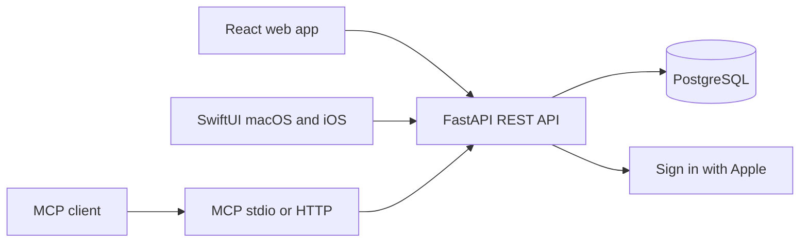

# Architecture

The server is the source of truth for authorization, validation, recurrence, and conflict detection. The browser, native apps, and MCP tools all use the same API. Task updates compare the expected version in an atomic database statement; successful writes increment it. A recurring successor is created in the same transaction as completion. Checklists are ordered JSON arrays on tasks and share the parent task version. Completion checks every item; recurring successors copy the list with unchecked items. Browser state refreshes after mutation, on focus, and at a 30-second interval. Native clients refresh on activation or user request.

Authentication has two layers. Apple verifies identity during sign-in; Taskwell then creates an opaque database session. Web sessions use HttpOnly cookies with Origin validation on writes. Native sessions are bearer credentials held in Keychain. Integration tokens use the same lookup and ownership enforcement but cannot manage other credentials or delete the account. HTTP MCP requires a bearer credential at the boundary and forwards it to the API for every tool call. Each user-owned query is scoped to the credential's user ID.

The deployment image serves the compiled React assets, REST endpoints, and HTTP MCP. PostgreSQL is external on App Platform and an internal Compose service on a Droplet. Alembic runs before application deployment. Development startup also applies migrations, backing up and adopting the original unversioned SQLite schema when it matches the known initial schema. Production rejects local demo login and unsafe secret, URL, and database defaults.

Source map:

- `api/taskwell/auth.py`: Apple challenges, code exchange, token validation, credentials, revocation.
- `api/taskwell/main.py`: resource routes, ownership checks, atomic writes, recurrence, HTTP MCP mount, static files.
- `api/taskwell/db.py`, `schemas.py`: persistence and validated contracts.
- `api/taskwell/mcp_server.py`: official SDK tools and API adapter.
- `web/src`: React app, API client, responsive styles. `glassive.css` holds the Glassive design tokens (light and dark); `style.css` builds the interface from them.
- `apple/Taskwell`: SwiftUI app, API client, observable store and Keychain storage. `Glassive.swift` mirrors the same color tokens for the native apps.
- `api/migrations`: immutable deployment migrations.

Known first-release limits are listed in the README. In particular, refresh polling is not real-time push; no offline write queue exists; PostgreSQL labels are stored as JSON and label filtering is currently performed after the user-scoped query, which should be moved to an indexed query if accounts grow very large.
